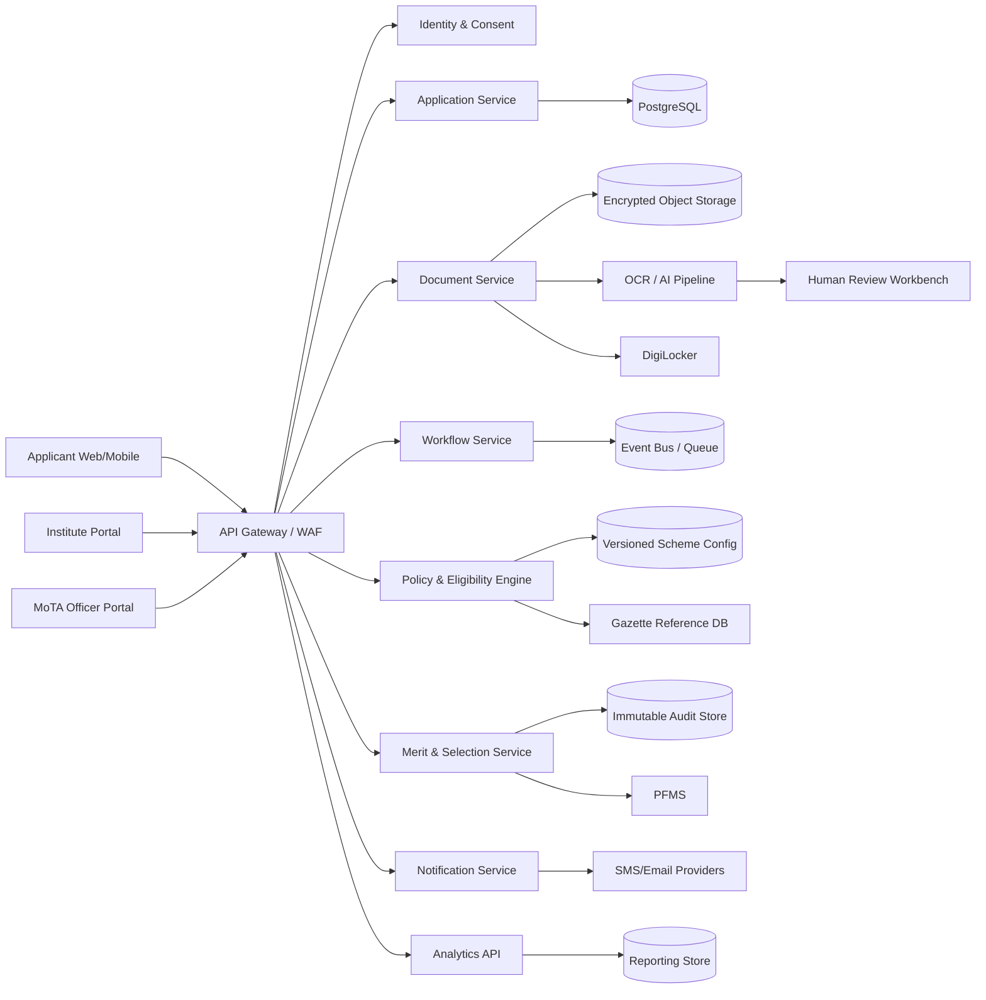
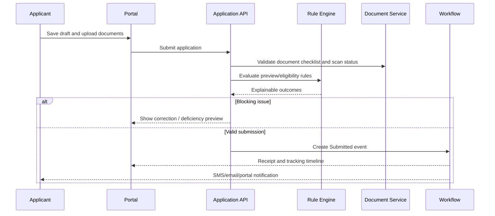
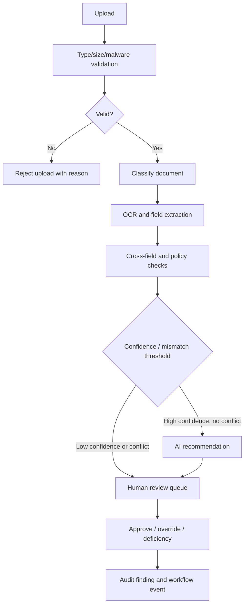
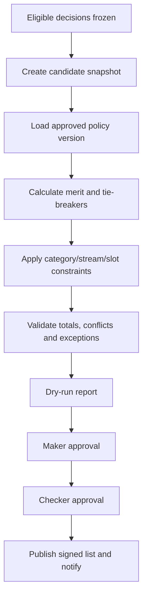
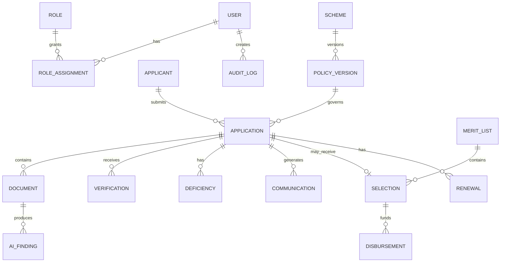
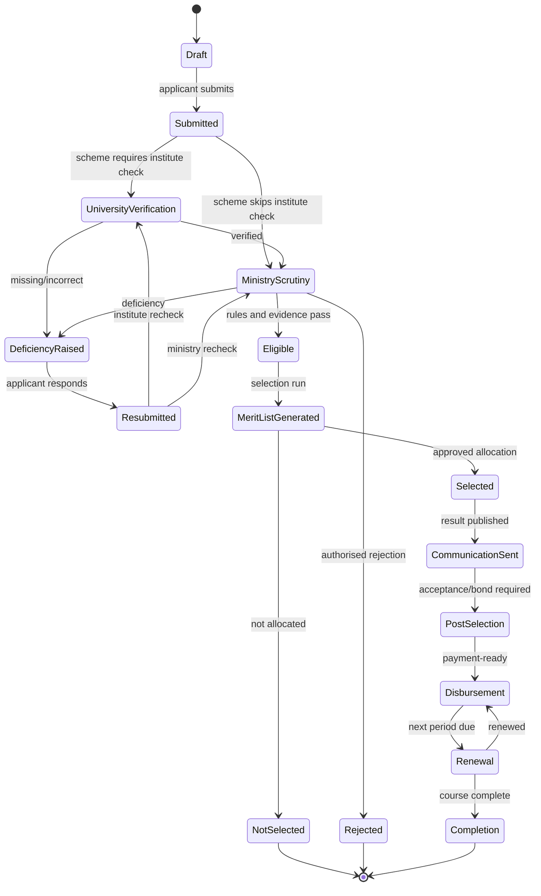

# TribalOne — Product Requirements Document
## AI-Enabled Scholarship and Fellowship Management System for Scheduled Tribes

**Ministry:** Ministry of Tribal Affairs (MoTA), Government of India  
**Problem Statement ID:** 26239  
**Category / Theme:** Software / Smart Education  
**Document status:** Draft for stakeholder review  
**Version:** 1.0  
**Date:** 30 September 2026  
**Author:** Manus AI  
**Primary audience:** MoTA, engineering, design, implementation partners, SIH evaluators

> **Policy note:** Scheme rules, thresholds, slot allocations, eligible institutions, document formats and payment rates are policy-controlled data. TribalOne must never hardcode them. The values in this PRD are illustrative baseline values derived from the supplied problem brief and official MoTA publications; the applicable government notification for the relevant academic year is the source of truth. [1] [2] [3]

---

## 1. Document Control

### 1.1 Approvals

| Role | Name / office | Responsibility | Status |
|---|---|---|---|
| Business owner | MoTA scheme owner | Scope, policy and funding approval | Pending |
| Product owner | MoTA nominated officer | Backlog and acceptance decisions | Pending |
| Technology approver | MoTA / NIC architecture authority | Architecture, security and hosting | Pending |
| Data protection authority | Designated MoTA privacy officer | Privacy, retention and consent | Pending |
| Finance approver | MoTA / PFMS nodal officer | Disbursement and reconciliation | Pending |
| UAT approver | MoTA programme steering committee | Production go-live | Pending |

### 1.2 Revision history

| Version | Date | Author | Change |
|---|---|---|---|
| 0.1 | 30 Sep 2026 | Manus AI | Initial structure and scope |
| 1.0 | 30 Sep 2026 | Manus AI | Complete draft for review |

### 1.3 Normative language

- **Must / Shall:** mandatory for release acceptance.
- **Should:** expected unless an approved exception exists.
- **Could:** useful enhancement if capacity permits.
- **Won't:** explicitly excluded from the stated release.

---

## 2. Executive Summary

TribalOne is a unified, secure and configurable platform for end-to-end administration of MoTA scholarships and fellowships for Scheduled Tribe students. It replaces fragmented portals and manual correspondence with one applicant experience, one operational workbench and one auditable record of every decision from registration through completion.

The platform will support schemes such as National Fellowship for ST Students (NFST), National Overseas Scholarship (NOS), Top Class Education and future schemes through versioned configuration rather than code changes. Each scheme configuration contains eligibility rules, document requirements, workflow, slot allocation, selection criteria, communication templates, payment rules and effective dates.

TribalOne combines deterministic policy automation with AI assistance. OCR and document models extract fields from certificates and marksheets, compare them with the application, detect likely deficiencies, and surface caste-name variations for review against an approved Gazette reference set. AI recommends; an authorised human approves, overrides or rejects with a reason. No applicant is rejected solely by an opaque model.

The target impact is approximately 60% lower median processing time, 70% lower repetitive manual verification, 100% traceability of material decisions, faster deficiency resolution and improved visibility for MoTA leadership. The system must remain accessible on low bandwidth, support English, Hindi and progressively other Indian languages, and comply with applicable government security, privacy and accessibility obligations.

### Expected outcomes

| Outcome | Baseline problem | Target after stabilisation |
|---|---|---|
| Processing speed | Multiple portals and correspondence loops | 60% reduction in median submission-to-decision time |
| Verification effort | Manual document review | 70% reduction in repetitive checks, with human control retained |
| Transparency | Limited status visibility | Applicant self-service status and stage-level SLA visibility |
| Policy agility | Rules hardcoded in applications | New scheme/version deployable through controlled configuration |
| Selection integrity | Manual slot distribution and spreadsheets | Reproducible, signed merit-list runs with slot-cap validation |
| Payment visibility | Weak post-selection tracking | Application-to-payment-to-renewal traceability |

---

## 3. Problem Statement

### 3.1 Background

MoTA provides financial assistance to ST students pursuing higher education in India and abroad. The official MoTA scholarship page describes NFST as a central sector programme with 750 fresh fellowships per year and records that the Ministry also administers Top Class and NOS-related programmes. [1] The 2025–26 NOS FAQ records 20 awards, comprising 17 ST and 3 PVTG awards, six female earmarks, an annual family-income ceiling of ₹6 lakh and stream allocations of 10 STEM, 4 Management/Economics/Finance/Law, 4 Agriculture/Medicine and 2 Humanities/Social Science. [3]

The supplied problem brief identifies an actual lifecycle of Draft → Submitted → University Verification → Ministry Scrutiny → Deficiency → Resubmission → Eligible/Rejected → Merit List → Selected → Communication → Post-Selection → Disbursement → Renewal → Completion. TribalOne will implement this as a configurable state machine with scheme-specific variants.

### 3.2 Current-state pain points

1. Applicants navigate fragmented portals for different schemes.
2. Scrutineers repeat manual checks across caste, income, DOB, marks and admission documents.
3. Deficiency communication is not consistently structured or traceable.
4. Policy thresholds and slot rules are often maintained in code, spreadsheets or instructions.
5. Stream-wise and priority-category slot allocation is vulnerable to manual error.
6. Caste-name spelling variations can cause false verification failures.
7. Officials lack a real-time operational view of ageing, bottlenecks and scheme performance.
8. Post-selection continuation, payment and renewal data is disconnected from the original application.

### 3.3 Stakeholder impact

| Stakeholder | Impact |
|---|---|
| Applicant | Repeated uploads, uncertainty, travel or help-desk dependency, missed deadlines |
| Institute | Manual queues, unclear return reasons, difficult bulk verification |
| Scrutineer | High-volume repetitive review and inconsistent prioritisation |
| MoTA administrator | Spreadsheet reconciliation, policy change risk and weak auditability |
| Leadership | Delayed or incomplete metrics on reach, equity, payment and outcomes |
| Finance / PFMS team | Rework caused by invalid bank or beneficiary data and weak reconciliation |

### 3.4 Problem measures to baseline in discovery

Before production rollout, the product owner must establish baselines for application volume, completion rate, median processing time, deficiency rate, average number of resubmissions, institute turnaround time, payment failure rate, grievance resolution time and applicant CSAT. Until measured, targets in this document are hypotheses rather than guarantees.

---

## 4. Goals, Objectives and Non-goals

### 4.1 Business goals

- Create a single source of truth for MoTA scholarship and fellowship administration.
- Improve equitable, policy-compliant access for ST and PVTG applicants.
- Reduce avoidable manual work without removing accountable human decisions.
- Provide timely, explainable and reproducible selection.
- Increase payment and continuation visibility.
- Make scheme expansion configuration-led.

### 4.2 Product goals

- Complete a valid application in multiple saved sessions on mobile or desktop.
- Surface a clear, actionable reason for every deficiency or ineligibility result.
- Provide role-specific work queues with SLA and ageing indicators.
- Preserve immutable evidence for every material action.
- Integrate with approved government systems using consent, least privilege and resilient retries.

### 4.3 Non-goals

- TribalOne will not create or change scheme policy; it will execute approved policy versions.
- TribalOne will not make final high-impact eligibility or selection decisions autonomously.
- TribalOne will not replace PFMS, DigiLocker, Aadhaar or authoritative issuing authorities.
- TribalOne will not provide a general student learning-management system.
- TribalOne will not expose Aadhaar numbers or sensitive documents in public merit lists.
- TribalOne will not permit direct payment execution without authorised PFMS controls.

---

## 5. Scope

### 5.1 MVP scope

- Applicant account, profile, consent and application wizard.
- Scheme catalogue and versioned configuration.
- Document upload, virus scanning, metadata and document checklist.
- Basic deterministic eligibility rules and explainable outcomes.
- Institute verification for configured schemes.
- Deficiency creation, response and resubmission.
- Ministry scrutiny queue, decisioning and audit trail.
- Applicant and officer notifications.
- Operational dashboard, exports and grievance-linked case history.

### 5.2 Phase 2 scope

- OCR, document classification, field extraction and fuzzy matching.
- Human-in-the-loop AI review workbench.
- Reproducible merit-list generation and approval ceremony.
- Advanced dashboards, alerts, multilingual content and bulk actions.
- DigiLocker and Gazette-reference integrations.

### 5.3 Phase 3 scope

- PFMS payment instruction/status integration.
- Renewal, continuation certificate, bond and progress tracking.
- Payment reconciliation, exception handling and beneficiary self-service.

### 5.4 Phase 4 scope

- Additional schemes and state/UT variants.
- Predictive workload forecasting and anomaly triage.
- Outcome analytics, institute benchmarking and controlled policy simulation.

### 5.5 Assumptions and dependencies

- MoTA supplies approved scheme notifications, forms, templates, institution lists and role mapping.
- Each external integration has a nominated owner, sandbox and production contract.
- Authoritative Gazette, institution, bank and payment data is available through approved interfaces or governed imports.
- Hosting, security accreditation, SMS/email sender IDs and language translations are provisioned before go-live.
- Legal and privacy review confirms lawful basis, notices, retention and consent patterns.

---

## 6. Stakeholders and Personas

| Persona | Goals | Pain points | Needs |
|---|---|---|---|
| Applicant | Apply correctly, understand status, receive funds | Fragmented portals, document uncertainty, low bandwidth | Guided wizard, save/resume, plain-language reasons, accessible support |
| Institute official | Verify admission and certificates efficiently | Bulk queues, unclear rejection reasons | Work queue, bulk verification, delegation and evidence view |
| MoTA scrutineer | Make consistent, defensible decisions | Repetitive review, missing context | AI-assisted checklist, comparison view, reason codes, escalation |
| MoTA admin | Configure schemes and run selection | Code dependency, spreadsheets | Versioned rule builder, dry run, approval and rollback |
| Leadership | Monitor delivery and equity | Delayed reports, fragmented data | Trusted dashboards, drill-down, export and trend view |
| Finance/PFMS nodal officer | Release and reconcile funds | Payment errors and disconnected records | Validated batches, status callbacks, reconciliation queue |
| Help-desk/grievance officer | Resolve applicant issues | No single case history | Unified timeline, masked access, SLA and communication tools |

---

## 7. User Stories and Use Cases

### 7.1 Applicant stories

| ID | User story | Acceptance criteria |
|---|---|---|
| US-APP-001 | As an applicant, I want to register with mobile/email OTP so that I can securely access my account. | OTP expires; rate limits apply; duplicate identity is detected; successful registration creates a profile and audit event. |
| US-APP-002 | As an applicant, I want to save a draft so that I can complete the form across multiple sessions. | Draft autosaves; incomplete fields are marked; refresh/logout does not lose saved data; draft cannot enter scrutiny until submitted. |
| US-APP-003 | As an applicant, I want to upload documents against a checklist so that I know what is missing. | Allowed type/size is enforced; upload receipt is shown; malware scan runs; checklist status updates. |
| US-APP-004 | As an applicant, I want an eligibility preview so that I can correct issues before submission. | Preview shows pass, fail or needs-review per rule with source field and policy version; preview is non-final. |
| US-APP-005 | As an applicant, I want to respond to a deficiency so that my application can be reconsidered. | Each deficiency has reason, required evidence and due date; response is versioned; resubmission produces an acknowledgement. |
| US-APP-006 | As an applicant, I want to track my application so that I know the next action and expected time. | Timeline shows current state, prior states, timestamps, owner category and applicant action; sensitive internal notes are hidden. |
| US-APP-007 | As a selected applicant, I want to submit continuation evidence so that my fellowship or scholarship remains active. | Required certificate list is scheme-driven; submission is validated; renewal decision and payment status are visible. |

### 7.2 Institute stories

| ID | User story | Acceptance criteria |
|---|---|---|
| US-INS-001 | As an institute official, I want a verified institute queue so that I can process only applications assigned to my institute. | Access is restricted by institute and scheme; queue supports filters and SLA sorting; every action is logged. |
| US-INS-002 | As an institute official, I want to compare application fields with documents so that I can verify facts accurately. | Side-by-side values show source document, extraction confidence and manual override reason. |
| US-INS-003 | As an institute official, I want to return a structured deficiency so that the applicant knows exactly what to fix. | Reason code, comment, evidence type and due date are mandatory; applicant notification is generated. |
| US-INS-004 | As an institute nodal officer, I want to bulk attest eligible applications so that routine processing is efficient. | Bulk action requires review summary and confirmation; failures are itemised; no mixed-state item is silently changed. |

### 7.3 Scrutineer stories

| ID | User story | Acceptance criteria |
|---|---|---|
| US-SCR-001 | As a scrutineer, I want a prioritised work queue so that ageing and high-risk cases are handled first. | Queue supports configurable SLA, completeness, risk and scheme filters; assignment is exclusive or explicitly shared. |
| US-SCR-002 | As a scrutineer, I want AI findings with evidence so that I can review faster without trusting a black box. | Every finding links to document region, extracted value, confidence and rule; approve, override or reject requires reason. |
| US-SCR-003 | As a scrutineer, I want to raise a deficiency with reusable templates so that correspondence is consistent. | Templates are versioned and localisable; selected reasons appear in applicant language; notification is logged. |
| US-SCR-004 | As a scrutineer, I want to record an explainable eligibility decision so that it withstands audit. | Decision stores policy version, input snapshot, rule outcomes, reviewer, timestamp and reason. |

### 7.4 Admin stories

| ID | User story | Acceptance criteria |
|---|---|---|
| US-ADM-001 | As an admin, I want to configure a new scheme without code changes so that policy can be launched quickly. | Admin can create draft configuration; validation catches missing fields; publication requires approval and effective date. |
| US-ADM-002 | As an admin, I want to run a dry-run selection so that slot errors are found before publication. | Dry run uses an immutable input snapshot; allocation totals reconcile; conflicts and unfilled reserved slots are reported. |
| US-ADM-003 | As an admin, I want to publish a policy version so that future applications use the approved rules. | Published version is immutable; applications retain the version used; rollback creates a new version rather than editing history. |
| US-ADM-004 | As an admin, I want to manage roles and templates so that least privilege is maintained. | Changes require authorised role, reason and audit event; dangerous permissions require dual control. |

### 7.5 Leadership stories

| ID | User story | Acceptance criteria |
|---|---|---|
| US-LEAD-001 | As a leader, I want a live scheme dashboard so that I can see volume, ageing, selection and payment status. | Metrics have timestamp, definition and drill-down; filters preserve confidentiality; exports are watermarked. |
| US-LEAD-002 | As a leader, I want equity and outcome views so that policy performance can be assessed. | Dashboard can segment by scheme, state, gender, PVTG/PwD and other approved dimensions with suppression for small cells. |

---

## 8. Functional Requirements

### 8.1 Authentication and role management

| ID | Requirement | Priority | Acceptance criteria |
|---|---|---|---|
| FR-AUTH-001 | Support applicant registration and login using verified mobile/email OTP, passwordless recovery and optional approved eKYC. | Must | OTP, expiry, retry and lockout controls pass security tests; no account enumeration. |
| FR-AUTH-002 | Support SSO/OAuth 2.0 or approved government identity federation for officials. | Must | Official login maps to an approved organisation, role and institute; token expiry and revocation work. |
| FR-AUTH-003 | Enforce RBAC with scope by role, scheme, institute, geography and action. | Must | Authorisation is checked server-side for every protected API and UI action; negative tests pass. |
| FR-AUTH-004 | Support maker-checker approval for configuration, merit list and payment batches. | Must | Creator cannot be sole approver; approval captures decision, timestamp and policy version. |
| FR-AUTH-005 | Provide session management, MFA for privileged users, rate limiting and device/session revocation. | Must | Privileged MFA is mandatory; revoked sessions fail; rate-limit events are monitored. |

### 8.2 Applicant registration and profile

| ID | Requirement | Priority | Acceptance criteria |
|---|---|---|---|
| FR-PROF-001 | Maintain a reusable applicant profile with personal, contact, domicile, category, education, bank and consent data. | Must | Field validation is scheme-aware; edits are versioned; sensitive fields are masked. |
| FR-PROF-002 | Prevent conflicting identity records using configured matching keys and human review. | Must | Potential duplicates are queued; no automatic merge deletes evidence. |
| FR-PROF-003 | Provide multilingual, mobile-responsive forms with save/resume and accessible error messages. | Must | WCAG 2.1 AA checks pass for core flows; form state survives interruption. |
| FR-PROF-004 | Capture consent, notice acknowledgement and communication preferences separately. | Must | Consent purpose, version, timestamp and withdrawal status are stored and retrievable. |

### 8.3 Scheme configurator

| ID | Requirement | Priority | Acceptance criteria |
|---|---|---|---|
| FR-SCHEME-001 | Allow authorised admins to create scheme, academic-year and policy versions from JSON/YAML or a validated UI. | Must | Schema validation blocks publication of invalid configs; version is immutable after publication. |
| FR-SCHEME-002 | Configure eligibility, documents, workflow, slots, selection, communication, deadlines and payment parameters. | Must | Each parameter is typed, traceable to an approval and testable in preview. |
| FR-SCHEME-003 | Support effective dates and grandfathering so in-flight applications retain their governing rules. | Must | Historical application recalculation uses its stored policy version unless an approved migration exists. |
| FR-SCHEME-004 | Provide configuration diff, test cases, dry run and two-person publication. | Must | Diff identifies changed thresholds and lists; test results are attached to approval. |
| FR-SCHEME-005 | Permit custom fields and conditional document requirements without application code changes. | Should | A new sample scheme can be configured and tested end-to-end without deployment. |

### 8.4 Application management

| ID | Requirement | Priority | Acceptance criteria |
|---|---|---|---|
| FR-APP-001 | Create one application per scheme and academic year, with draft/submitted timestamps and immutable submission receipt. | Must | Duplicate submissions are prevented or linked; receipt includes application ID and policy version. |
| FR-APP-002 | Validate mandatory fields, cross-field consistency and submission deadline. | Must | Blocking errors are actionable; after cutoff submission is rejected with policy-backed reason. |
| FR-APP-003 | Allow applicant withdrawal before a configured decision state. | Should | Withdrawal rules are scheme-specific; evidence and reason remain auditable. |
| FR-APP-004 | Provide application timeline, downloadable receipt and status notifications. | Must | Timeline is consistent across portal, API and officer view. |

### 8.5 Document upload and management

| ID | Requirement | Priority | Acceptance criteria |
|---|---|---|---|
| FR-DOC-001 | Maintain scheme-specific checklist for DOB, ST/PVTG, income, marks, admission, domicile, photo and other documents. | Must | Checklist is rendered from policy version; required/optional logic is correct. |
| FR-DOC-002 | Enforce file type, size, page count, image quality and malware scanning. | Must | Invalid files are rejected before persistence; scan result is logged. |
| FR-DOC-003 | Store immutable originals and derived previews with access control and retention metadata. | Must | Original hash is recorded; download is authorised and logged. |
| FR-DOC-004 | Allow replacement only as a new document version, preserving superseded evidence. | Must | Reviewer can see version lineage and the document used for the decision. |
| FR-DOC-005 | Support DigiLocker retrieval with explicit, revocable, purpose-bound consent. | Should | User sees requested document/scope; token is not stored in plaintext; access is logged. |

### 8.6 AI/OCR document scrutiny

| ID | Requirement | Priority | Acceptance criteria |
|---|---|---|---|
| FR-AI-001 | Classify uploaded files into configured document types and route uncertain cases to human review. | Should | Model returns label, confidence and alternatives; below threshold is not auto-accepted. |
| FR-AI-002 | Extract configured fields such as name, DOB, income, caste, marks, institute and dates. | Should | Each field has value, confidence, page/region and model version. |
| FR-AI-003 | Compare extracted values with application fields and detect mismatch, missing or stale evidence. | Must | Findings use deterministic reason codes and link to both sources. |
| FR-AI-004 | Provide caste spelling similarity against an approved Gazette/reference dataset without silently changing applicant data. | Should | Match method, candidates and score are visible; human accepts or records exception. |
| FR-AI-005 | Capture reviewer disposition of every AI finding and monitor false positives/negatives. | Must | AI decision log supports sampling, model versioning and rollback. |

### 8.7 Eligibility engine

| ID | Requirement | Priority | Acceptance criteria |
|---|---|---|---|
| FR-ELIG-001 | Evaluate typed, deterministic rules for age, marks, income, category, stream, institute, admission and duplicate-benefit constraints. | Must | Results are pass/fail/needs-review with explanation and policy source. |
| FR-ELIG-002 | Support rule dependencies, exemptions, date anchors and priority categories. | Must | Test suite covers boundary dates, missing values and exception paths. |
| FR-ELIG-003 | Freeze the input snapshot and engine version at decision time. | Must | Re-running with changed profile does not rewrite past decisions. |
| FR-ELIG-004 | Permit human override only with authorised role and reason. | Must | Override is visible in audit and included in reports. |

### 8.8 Deficiency workflow

| ID | Requirement | Priority | Acceptance criteria |
|---|---|---|---|
| FR-DEF-001 | Generate structured deficiencies from checklist, rule and reviewer findings. | Must | Each deficiency includes code, explanation, evidence required, owner and due date. |
| FR-DEF-002 | Notify applicant through portal, SMS and/or email according to preference and policy. | Must | Delivery status, retry and failure are recorded; message uses approved template. |
| FR-DEF-003 | Allow partial response and resubmission with document versioning. | Must | Only unresolved items block progress; resolved items remain traceable. |
| FR-DEF-004 | Escalate overdue deficiencies and permit approved extension. | Should | Escalation follows scheme SLA; extension requires reason and authority. |

### 8.9 Workflow and state management

| ID | Requirement | Priority | Acceptance criteria |
|---|---|---|---|
| FR-WF-001 | Implement configurable lifecycle states including Draft, Submitted, Verification, Scrutiny, Deficiency, Resubmitted, Eligible, Rejected, Merit, Selected, Post-Selection, Disbursement, Renewal and Completion. | Must | Only configured transitions are accepted; invalid transition returns a clear error. |
| FR-WF-002 | Enforce state entry/exit guards and role permissions. | Must | Transition cannot occur without required evidence, decision or approval. |
| FR-WF-003 | Support assignment, reassignment, queues, SLA timers and bulk actions. | Must | Every assignment and bulk result is itemised and logged. |
| FR-WF-004 | Publish domain events for transitions and integrations. | Must | Events are idempotent, ordered per application and retryable. |

### 8.10 Merit list and selection

| ID | Requirement | Priority | Acceptance criteria |
|---|---|---|---|
| FR-MERIT-001 | Build an eligible candidate snapshot from approved decisions. | Must | Candidate count reconciles to filters; ineligible or duplicate records are excluded with reasons. |
| FR-MERIT-002 | Apply configurable merit score, tie-breakers, priority categories, stream buckets and slot caps. | Must | Dry-run allocation totals equal available slots and identify unfilled buckets. |
| FR-MERIT-003 | Produce reproducible merit list with run ID, inputs, rules, code/model versions and checksum. | Must | Same snapshot/config produces same result; changes create a new run. |
| FR-MERIT-004 | Require human approval before publication and communication. | Must | Maker-checker approval and published-list hash are stored. |
| FR-MERIT-005 | Publish only minimum necessary personal data and provide applicant-specific result lookup. | Must | Public output masks PII and passes privacy review. |

### 8.11 Communication and notification

| ID | Requirement | Priority | Acceptance criteria |
|---|---|---|---|
| FR-COMM-001 | Manage versioned multilingual SMS, email and portal templates by event and scheme. | Must | Template approval and effective dates are enforced. |
| FR-COMM-002 | Trigger notifications on submission, deficiency, decision, selection, payment and renewal events. | Must | Duplicate events do not create duplicate messages; delivery status is tracked. |
| FR-COMM-003 | Provide applicant inbox and downloadable official letters. | Must | Letters show application ID, date, policy context and verification method. |
| FR-COMM-004 | Provide communication history to authorised officials and grievance staff. | Should | Access is masked and logged. |

### 8.12 Post-selection management

| ID | Requirement | Priority | Acceptance criteria |
|---|---|---|---|
| FR-POST-001 | Capture bond, joining, continuation, progress, attendance, thesis or completion evidence as scheme-configured. | Must | Missing or expired evidence creates a task or deficiency. |
| FR-POST-002 | Create validated disbursement batches and export/integrate with PFMS. | Must | Batch is maker-checker approved; schema and bank validation errors are surfaced before submission. |
| FR-POST-003 | Ingest PFMS payment status and reconcile amount, beneficiary, transaction and failure reason. | Must | Idempotent status updates link to the application and batch. |
| FR-POST-004 | Support renewal decision, suspension, restoration and completion. | Must | Each decision has policy version, evidence, reason and effective date. |

### 8.13 Analytics and dashboards

| ID | Requirement | Priority | Acceptance criteria |
|---|---|---|---|
| FR-ANA-001 | Show operational KPIs for volume, completeness, ageing, deficiency, scrutiny, selection and payment. | Must | Metric definitions, timestamp and filter scope are visible. |
| FR-ANA-002 | Provide role-specific dashboards and row-level access controls. | Must | Users see only authorised schemes, institutes and geography. |
| FR-ANA-003 | Support CSV/XLSX/PDF export with watermark, purpose and export audit. | Should | Export respects filters, masking and row limits. |
| FR-ANA-004 | Provide approved equity cuts with small-cell suppression. | Should | Sensitive segmentation requires permission and suppression thresholds. |

### 8.14 Audit and compliance

| ID | Requirement | Priority | Acceptance criteria |
|---|---|---|---|
| FR-AUD-001 | Log authentication, data access, document access, configuration, AI finding, decision, transition and export events. | Must | Required fields are present; log cannot be altered by application admins. |
| FR-AUD-002 | Provide case timeline and evidence bundle for audit or grievance review. | Must | Bundle includes source documents, decisions, policy versions and hashes. |
| FR-AUD-003 | Support retention, legal hold, redaction and controlled deletion workflows. | Must | Deletion requires policy, authority and audit; legal hold prevents deletion. |
| FR-AUD-004 | Detect anomalous privileged access and repeated failed actions. | Should | Alerts are generated and triaged without exposing unnecessary PII. |

### 8.15 Integrations

| ID | Requirement | Priority | Acceptance criteria |
|---|---|---|---|
| FR-INT-001 | Integrate DigiLocker as an approved requester using OAuth 2.0/OpenID Connect and scoped consent. | Should | Consent and revocation work; retrieved documents are provenance-tagged. |
| FR-INT-002 | Integrate PFMS for approved payment and status flows. | Must | Contract tests cover validation, timeout, retry, duplicate and reconciliation. |
| FR-INT-003 | Integrate Gazette/reference data for caste-name verification. | Should | Dataset version, refresh date and source authority are stored. |
| FR-INT-004 | Integrate SMS/email gateways with delivery receipts and provider failover. | Must | Outage queues messages; retries are bounded and observable. |
| FR-INT-005 | Import legacy MoTA portal records with mapping, validation and reconciliation report. | Must | Source ID is preserved; rejected rows have actionable errors; migration sign-off exists. |

---

## 9. Non-Functional Requirements

| ID | Area | Requirement and acceptance target |
|---|---|---|
| NFR-PERF-001 | Performance | 95th percentile page/API response ≤2 seconds for common reads at target load; upload acknowledgement ≤5 seconds excluding external OCR. |
| NFR-PERF-002 | Scale | Design for at least 10 lakh applicant profiles, 5 lakh annual applications, 2 lakh concurrent sessions burst capacity, and 10,000 document-processing jobs/day; final capacity is load-tested. |
| NFR-SEC-001 | Security | TLS 1.2+ in transit, AES-256 or managed equivalent at rest, envelope key management, secrets vault and key rotation. |
| NFR-SEC-002 | Identity | MFA for privileged roles, strong session controls, server-side RBAC/ABAC and OWASP ASVS-aligned testing. |
| NFR-SEC-003 | PII | Aadhaar and sensitive identifiers are tokenised/masked; raw values are not used as general-purpose identifiers. |
| NFR-SEC-004 | Audit | Tamper-evident, time-synchronised audit logs retained per approved schedule and exportable for investigation. |
| NFR-AVAIL-001 | Availability | 99.9% monthly availability for applicant and officer portals, excluding approved maintenance. |
| NFR-AVAIL-002 | Recovery | RPO ≤15 minutes and RTO ≤4 hours for production; quarterly restore test and annual DR exercise. |
| NFR-SCALE-001 | Architecture | Stateless services, horizontal scaling, queues for OCR/notifications, object storage for documents and read replicas/caching where justified. |
| NFR-A11Y-001 | Accessibility | Core journeys meet WCAG 2.1 AA: keyboard access, labels, focus, contrast, captions/text alternatives and screen-reader semantics. |
| NFR-LOC-001 | Language | English and Hindi at MVP; architecture supports regional languages, translated templates and locale-aware dates/numbers. |
| NFR-UX-001 | Usability | Mobile-first, low-bandwidth mode, resumable uploads, clear errors, no mandatory one-sitting completion and accessible help. |
| NFR-COMP-001 | Compliance | Privacy notices, consent, purpose limitation, data minimisation, rights handling and breach processes align to applicable DPDP requirements and government policy. [4] |
| NFR-OPS-001 | Observability | Central logs, metrics, traces, queue depth, integration health, model drift and business SLA alerts with on-call runbooks. |
| NFR-PORT-001 | Portability | Containerised deployment supports NIC Cloud or approved AWS/Azure environment with infrastructure as code and documented exit plan. |

---

## 10. System Architecture

### 10.1 High-level architecture



### 10.2 Component responsibilities

- **Web clients:** accessible responsive UI; no policy decisions trusted from client.
- **API gateway/WAF:** routing, throttling, authentication enforcement and threat protection.
- **Identity and consent:** applicant identity, official federation, sessions, consent records and purpose binding.
- **Application service:** profiles, applications, drafts, submission receipts and validations.
- **Document service:** upload, scan, metadata, versioning, preview, retention and access control.
- **AI pipeline:** asynchronous classification/extraction/matching with model registry and human review.
- **Policy engine:** typed rules and policy-version evaluation; deterministic, explainable output.
- **Workflow service:** state transitions, tasks, SLA timers, assignments and domain events.
- **Selection service:** candidate snapshots, slot allocation, merit calculation and approval.
- **Integration adapters:** contract-isolated clients for DigiLocker, PFMS, Gazette and messaging.
- **Reporting store:** curated, masked aggregates; operational database is not queried for heavy reports.

### 10.3 Submission data flow



### 10.4 Document scrutiny flow



### 10.5 Merit-list flow



### 10.6 Integration principles

All external calls use adapter interfaces, correlation IDs, timeouts, idempotency keys, bounded retries, dead-letter queues and reconciliation reports. Integration data is provenance-tagged with source, timestamp, consent/purpose and contract version. External failure must not corrupt the core case record.

---

## 11. Data Model

### 11.1 Entity relationships



### 11.2 Key entities and attributes

| Entity | Key attributes |
|---|---|
| Applicant | applicant_id, masked identity key, name, DOB, category, PVTG/PwD flags, domicile, contact, consent status |
| User | user_id, identity provider ID, user type, status, last login, MFA state |
| Role / assignment | role, scope, institute, scheme, valid-from/to, approver status |
| Scheme | scheme_id, name, owner, active status |
| PolicyVersion | version, academic year, effective dates, config hash, approval record |
| Application | application_id, applicant_id, scheme/version, state, timestamps, submission receipt, risk flags |
| Document | document_id, type, version, object URI, hash, issuer, issue/expiry date, scan status, provenance |
| Verification | verification_id, application/document, verifier, decision, reason, evidence snapshot |
| AIFinding | finding_id, model/version, field, value, confidence, page/region, disposition |
| Deficiency | deficiency_id, code, description, due date, owner, status, response document IDs |
| MeritList | run_id, policy version, input snapshot hash, scoring rule, allocation result, approval status |
| Selection | selection_id, rank, category/stream bucket, status, communication date |
| Communication | channel, template version, payload hash, provider message ID, delivery status |
| Disbursement | batch ID, selection ID, instalment, amount, PFMS reference, status, failure reason |
| Renewal | academic year, evidence set, decision, next due date |
| AuditLog | event ID, actor, action, object, before/after hash, timestamp, IP/device metadata, correlation ID |

### 11.3 Data principles

- Separate identity vault data from operational data where feasible.
- Use surrogate IDs; do not expose Aadhaar or bank account numbers in URLs.
- Record all policy and model versions used for a decision.
- Encrypt backups and object storage; apply retention by document and case type.
- Use row-level security or service-layer policy enforcement for organisational boundaries.
- Maintain data quality rules for dates, annual income, marks conversion, certificate validity and duplicate identities.

---

## 12. AI/ML Components

### 12.1 Pipeline

1. Malware and file-quality gate.
2. Document classifier identifies type and language.
3. OCR produces text plus layout and confidence.
4. Field extractor identifies name, DOB, income, caste, marks, institute and dates.
5. Deterministic cross-validation compares extracted values with application and rules.
6. Fuzzy matcher proposes caste-name or spelling matches against approved reference data.
7. Anomaly detector flags suspicious patterns for human review; it does not decide eligibility.
8. Reviewer accepts, edits, rejects or requests a new document.

### 12.2 Targets and evaluation

| Component | Initial target | Release gate |
|---|---:|---|
| Document classification | ≥95% macro-F1 on representative validation set | Per-class precision/recall reported; low-confidence routing calibrated |
| Critical-field extraction | ≥95% exact/normalised match for DOB, income and marks; ≥90% for noisy names | Field-level confusion matrix; regional-language performance reported |
| Deficiency detection | ≥90% recall for mandatory missing/invalid documents | False-positive review rate acceptable to product owner |
| Fuzzy caste matching | High recall with human review; no silent auto-correction | Reference dataset version and threshold approved |
| Anomaly detection | Precision-first triage | No automatic adverse decision; bias and drift monitoring |

Targets must be recalibrated after a labelled pilot. Testing data must include scan quality, scripts, languages, issuing authorities, rural/urban variation and legitimate spelling variants.

### 12.3 Human-in-the-loop controls

- AI output is a recommendation with confidence and evidence location.
- High-impact actions require a human reviewer and reasoned decision.
- The system preserves the original applicant value and the extracted value separately.
- Reviewers can report an incorrect model result; labels enter the evaluation queue.
- Model versions are immutable, deployable behind feature flags and rollbackable.
- Sensitive attributes are not used for punitive risk scoring; approved equity monitoring is separated from decision logic.

### 12.4 Retraining and governance

Maintain a model card for each model, a labelled-data lineage, acceptance threshold, bias assessment, drift alert and rollback version. Retraining requires data-protection review, test-set holdout, acceptance metrics, change approval and post-deployment monitoring.

---

## 13. Rule Engine Design

### 13.1 Configuration schema

```yaml
schemeId: NFST
policyVersion: "2026-27.v1"
name: National Fellowship for ST Students
eligibility:
  - id: st_status
    type: enum
    field: applicant.category
    operator: in
    value: [ST]
  - id: masters_marks
    type: numeric
    field: education.masters_percentage
    operator: gte
    value: 55
  - id: age_limit
    type: date_age
    field: applicant.date_of_birth
    operator: lte
    value: 36
    asOf: application.cutoff_date
documents:
  - type: dob_certificate
    required: true
  - type: st_certificate
    required: true
    validation: gazette_name_match
  - type: masters_marksheet
    required: true
workflow:
  initial: Draft
  transitions:
    - from: Submitted
      to: UniversityVerification
      roles: [INSTITUTE_OFFICIAL]
    - from: MinistryScrutiny
      to: DeficiencyRaised
      roles: [SCRUTINEER]
selection:
  slots: 750
  score: masters_percentage
  tieBreakers: [female_priority, pwd_priority, pvtg_priority, application_timestamp]
  categoryRules:
    - key: PWD
      reservedPercent: 3
    - key: PVTG
      reservedSlots: 50
communication:
  templates:
    deficiency: NFST_DEFICIENCY_V1
postSelection:
  continuationDocuments: [continuation_certificate, progress_report]
```

NOS configuration must support 20 total awards, ST/PVTG distribution, female earmark, age/marks/income rules, QS-ranked institution criteria and stream buckets as applicable to the approved academic-year notification. [3]

### 13.2 Rule types

- **Eligibility:** age, marks, income, category, institution, course, admission and duplicate-benefit.
- **Document:** required type, issuer, validity, format, field and cross-check.
- **Workflow:** state, actor, transition guard, SLA and escalation.
- **Slot:** total, reserved, carried-forward, stream, gender, PVTG/PwD and fallback.
- **Selection:** score, weights, tie-breakers, ranking direction and approval.
- **Communication:** event, channel, language, template and retry policy.

### 13.3 Evaluation flow

`Load policy → validate input schema → normalise values → evaluate rules → produce explainable outcomes → apply human-review thresholds → persist snapshot → emit event`.

New schemes are added by creating a draft configuration, attaching approved documents/templates, running automated and sample-case tests, obtaining maker-checker approval and publishing an effective-dated version. Application code changes are not required for supported rule types.

---

## 14. UI/UX Requirements

### 14.1 Applicant portal

1. **Landing and scheme catalogue:** eligibility summary, dates, language switch and help.
2. **Registration/login:** OTP, consent and recovery.
3. **Profile:** progressive disclosure, source hints and save indicator.
4. **Application wizard:** stepper, completion percentage, inline validation and save/resume.
5. **Document centre:** checklist, upload progress, quality feedback, DigiLocker option and version history.
6. **Eligibility preview:** plain-language result with “what to fix” links.
7. **Review and submit:** field/document comparison, declaration, final confirmation and receipt.
8. **Timeline:** current state, next action, SLA, communications and grievance link.
9. **Post-selection:** bond, continuation, payment and renewal tasks.

### 14.2 Admin and officer dashboard

- KPI cards: submitted, pending, ageing, deficiency, eligible, selected, payment and renewal.
- Work queue with saved filters, bulk actions, assignment, SLA and escalation.
- Application review: profile, documents, extracted fields, rule outcomes, history and decision panel.
- Scheme configurator: schema form, diff, test cases, dry run, approvals and publish.
- Merit workspace: candidate snapshot, allocation matrix, exception report, approvals and signed output.
- Integration monitor: connector health, failed messages, retries and reconciliation.
- Audit explorer: case-centric and organisation-centric views with export controls.

### 14.3 Institute view

Institute-scoped queue, verification checklist, bulk actions, return templates, nodal-officer delegation, institute profile and turnaround dashboard. Institute users must not see applications outside their assignment.

### 14.4 Design principles

Use plain language, progressive disclosure, mobile-first layouts, high contrast, keyboard support, readable Hindi and future regional-language support, low-bandwidth patterns, explicit confirmation before irreversible actions, consistent reason codes and visible privacy notices.

---

## 15. Workflow and State Machine



### 15.1 State controls

| State | Permitted primary actor | Required evidence / guard | Notification |
|---|---|---|---|
| Draft | Applicant | Basic profile | Optional reminder |
| Submitted | Applicant/system | Mandatory fields, documents, declaration | Receipt |
| University Verification | Institute | Admission and configured certificates | Assigned queue |
| Ministry Scrutiny | Scrutineer | Verification result or scheme skip | Internal task |
| Deficiency Raised | Institute/scrutineer | Structured reason and due date | Applicant alert |
| Resubmitted | Applicant | Response evidence | Re-review task |
| Eligible/Rejected | Scrutineer/authorised officer | Rule snapshot, reason, override if any | Decision letter |
| Merit List Generated | Admin | Frozen eligible snapshot and run report | Internal approval |
| Selected | Checker/committee | Approved signed allocation | Selection letter |
| Disbursement | Finance role | Validated payment batch | Payment status |
| Renewal | Scrutineer | Continuation evidence and policy | Renewal result |
| Completion | System/officer | Completion evidence | Closure letter |

---

## 16. Reporting and Analytics

| Dashboard/report | Metrics |
|---|---|
| Executive scheme overview | Applications, eligible, selected, expenditure, processing time, coverage and trend |
| Operations | Queue size, ageing buckets, SLA breach, deficiency rate, resubmission count, reviewer productivity |
| Applicant funnel | Started, submitted, incomplete, deficient, eligible, selected, renewed and completed |
| Equity | ST/PVTG, gender, PwD, state/district and stream, with suppression rules |
| Institute performance | Assigned, verified, returned, turnaround and error/deficiency rate |
| AI quality | Classification/extraction confidence, overrides, false positives, drift and model version |
| Finance | Batch value, submitted, paid, failed, pending, reconciled and exception ageing |
| Grievance | New, open, SLA breach, resolved, category and CSAT |
| Audit/compliance | Privileged access, exports, overrides, configuration changes and retention actions |

Exports: CSV/XLSX for authorised operational analysis, PDF for signed reports, API for approved data consumers. Every export records actor, filter, purpose, row count, timestamp and watermark.

---

## 17. Security and Privacy

- Use defence in depth: WAF, secure headers, input validation, dependency scanning, secrets management, network segmentation and least-privilege service accounts.
- Encrypt data in transit and at rest. Separate document encryption keys from application database keys where feasible.
- Mask Aadhaar, bank and identity values by default. Use tokenisation and purpose-bound access for eKYC.
- Present a clear notice covering data collected, purpose, retention, sharing, contact and rights. Store versioned consent and withdrawal events.
- DigiLocker access must use user consent and OAuth 2.0/OpenID Connect; DigiLocker describes requester access as consent-based and revocable. [5]
- Implement data-subject request intake, verification, search, export/correction handling and approved deletion/legal-hold workflow.
- Maintain immutable or tamper-evident audit logs for decisions, data access, documents, exports and privileged actions.
- Conduct threat modelling, SAST/DAST, dependency scanning, penetration tests, vulnerability remediation and annual independent security review.
- Apply retention schedules by scheme, document type, grievance, payment and legal hold. Do not retain raw AI intermediate data beyond approved need.
- Public merit lists must use application IDs or masked identifiers and exclude sensitive documents.
- Maintain incident response playbooks for data breach, ransomware, integration compromise, model failure and payment error.

The DPDP Act is an important legal reference for the privacy design, but final obligations, rules and government instructions must be confirmed by MoTA legal/privacy authorities for the deployment context. [4]

---

## 18. Integrations

### 18.1 DigiLocker

TribalOne acts as an approved requester. The user is redirected through the authorised consent flow, selects the permitted document scope, and returns with a verifiable document reference. Store provenance and consent metadata, not unnecessary credentials. DigiLocker documents its requester model, OAuth 2.0/OIDC flow and revocable scope-level consent. [5]

### 18.2 PFMS

PFMS supports DBT, payment status, accounting, reconciliation and payment tracking. [6] TribalOne will prepare validated batches, send only after maker-checker approval, ingest statuses idempotently and expose failure reasons. Payment execution authority remains with the approved PFMS process.

### 18.3 Gazette/reference database

Use a versioned, authority-owned reference dataset for caste community names, scripts, aliases and effective notifications. Fuzzy matching is advisory; the authorised certificate and human review remain decisive.

### 18.4 SMS/email

Use approved government sender identity and templates. Implement delivery receipts, retries, provider health, dead-letter handling, language fallback and opt-out rules subject to scheme notification requirements.

### 18.5 Aadhaar/eKYC

Use only an approved legal and technical pathway, with explicit notice, purpose limitation, alternative route where required, masking and no unnecessary storage. Conduct a separate legal/security gate before activation.

### 18.6 Legacy migration

Profile source portals, map fields and document IDs, cleanse duplicates, migrate in batches, validate counts and hashes, reconcile exceptions and obtain business sign-off. Preserve source system ID and migration batch ID.

---

## 19. Testing Strategy

### 19.1 Test layers

- Unit tests for rules, allocation, state guards, masking and validation.
- Contract tests for PFMS, DigiLocker, Gazette and messaging adapters.
- Integration tests for application-to-document-to-workflow flows.
- System tests for each scheme configuration and role.
- UAT with applicants, institute officials, scrutineers, admins and finance officers.
- Accessibility, localisation, usability and low-bandwidth testing.
- Migration rehearsal and reconciliation testing.

### 19.2 AI/OCR testing

Maintain a sealed representative dataset with ground truth. Measure field-level precision, recall, F1, confidence calibration, regional-language performance, error severity and reviewer override rate. Test adversarial scans, cropped documents, handwritten content, duplicate uploads and legitimate spelling variants. No model ships without a human-review fallback.

### 19.3 Load and resilience

Test at the NFR scale with realistic document upload bursts, OCR queues, notification fan-out, merit-list runs, cache failure, database failover and external integration timeouts. Acceptance requires no lost application or payment event, bounded queue recovery and correct idempotency.

### 19.4 Security and privacy

Run threat modelling, SAST/DAST, API authorisation tests, session tests, malware tests, secrets scans, penetration tests, privacy review, backup restore and disaster recovery exercises. Critical unresolved findings block production.

---

## 20. Deployment and DevOps

### 20.1 Environments

- **Development:** synthetic data only; rapid feature development.
- **Test:** automated integration and security testing.
- **Staging/UAT:** production-like configuration, masked migration sample, external sandboxes.
- **Production:** approved government cloud, controlled access, monitored and backed up.

### 20.2 CI/CD

Pull request review → lint/unit tests → SAST/dependency scan → build signed container → integration tests → infrastructure plan → UAT approval → progressive production release. Scheme configuration follows a separate maker-checker publication pipeline and is not bundled invisibly into code releases.

### 20.3 Monitoring

Monitor API latency/error, authentication failures, queue depth, OCR throughput, model confidence/drift, database health, storage, integration success, workflow ageing, payment failures and business KPIs. Alerts must map to runbooks and an owner.

### 20.4 Rollback

Use blue/green or canary deployment for services. Roll back application binaries without mutating policy or audit history. For a bad policy, deactivate future use and publish a corrected version; never edit a policy already used in a decision.

---

## 21. Risks and Mitigations

| Risk | Likelihood | Impact | Mitigation |
|---|---|---|---|
| Policy changes after build | High | High | Versioned config, effective dates, approval and regression tests |
| OCR errors on poor or multilingual scans | High | High | Confidence thresholds, human review, applicant correction and labelled pilot |
| False caste-name mismatch | Medium | High | Reference-data governance, fuzzy suggestion only, human exception |
| External API downtime | Medium | High | Adapter isolation, queues, retries, manual fallback and reconciliation |
| Privacy/security incident | Medium | Critical | Minimise data, encryption, RBAC, monitoring, testing and response plan |
| Payment/bank validation failure | Medium | High | Pre-validation, PFMS status integration, exception queue and reconciliation |
| Low applicant digital literacy | High | Medium | Save/resume, multilingual UX, assisted channels, help desk and grievance flow |
| Institute verification backlog | Medium | High | SLA queue, delegation, escalation, bulk actions and leadership alerts |
| Merit-list allocation dispute | Medium | High | Frozen snapshot, reproducible run, explainable criteria, checker approval |
| Migration data quality issues | High | High | Profiling, dry runs, source IDs, reconciliation and staged cutover |
| Vendor/cloud lock-in | Medium | Medium | Containers, open interfaces, IaC, export and exit plan |
| Model drift or bias | Medium | High | Monitoring, periodic evaluation, model cards, rollback and human control |

---

## 22. Success Metrics and KPIs

| KPI | Definition | Baseline | Target | Cadence |
|---|---|---:|---:|---|
| Median processing time | Submitted to final eligibility/selection decision | To baseline | -60% | Monthly |
| Manual verification effort | Human minutes per complete application excluding exception review | To baseline | -70% repetitive effort | Monthly |
| Deficiency rate | Applications with at least one deficiency | To baseline | Downward trend; no quality trade-off | Weekly |
| Deficiency resolution time | Deficiency raised to valid resubmission | To baseline | -50% | Weekly |
| Audit coverage | Material actions with complete actor/policy/time/evidence trail | To baseline | 100% | Monthly |
| OCR critical-field accuracy | Exact/normalised field accuracy on validation sample | Pilot baseline | ≥95% target | Release/pilot |
| Payment success | Valid first-attempt disbursements | To baseline | ≥98% target after validation | Batch |
| Applicant CSAT | Post-interaction satisfaction | To baseline | ≥4/5 | Monthly |
| Portal availability | Production uptime excluding approved maintenance | To baseline | ≥99.9% | Monthly |
| Policy agility | New supported scheme/version from approved config to test-ready | To baseline | ≤10 business days | Per release |
| Selection reproducibility | Same snapshot/config yields same result | N/A | 100% | Every run |

Metrics must be segmented carefully. Lower processing time is not success if rejection, grievance or equity outcomes worsen.

---

## 23. Roadmap and Phases

| Phase | Scope | Exit criteria |
|---|---|---|
| Phase 1 — MVP | Auth, profile, application, documents, basic rules, deficiency, workflow, officer queue, admin dashboard | UAT passes core journeys; security/accessibility gates met; one pilot scheme live |
| Phase 2 — Intelligence and selection | OCR, classifier, extractor, fuzzy suggestions, AI review, merit list, communication, analytics | Pilot accuracy accepted; human-review controls; signed reproducible selection |
| Phase 3 — Lifecycle and payments | PFMS, disbursement, continuation, renewal, completion, reconciliation | Payment sandbox and DR tests pass; finance sign-off |
| Phase 4 — Expansion | Multi-scheme onboarding, regional languages, advanced analytics, anomaly triage | New scheme configured without code; outcome and equity reporting accepted |

### Indicative delivery sequence

1. Discovery, policy inventory, baseline and data protection impact assessment.
2. Design system, identity, profile, application and document foundation.
3. Workflow, rules, institute verification and scrutiny workbench.
4. Pilot with one scheme and representative institutes.
5. OCR/AI pilot on labelled data; merit-list dry run.
6. Production hardening, migration, PFMS and renewals.
7. Multi-scheme rollout and continuous improvement.

---

## 24. Appendices

### 24.1 Glossary

- **AI:** Artificial intelligence; used here as decision support, not autonomous adjudication.
- **DBT:** Direct Benefit Transfer.
- **DigiLocker:** Government digital document wallet and verification ecosystem.
- **DPDP:** Digital Personal Data Protection.
- **Gazette reference:** Approved government publication/data source for community-name validation.
- **NFST:** National Fellowship for Scheduled Tribe students.
- **NOS:** National Overseas Scholarship.
- **PVTG:** Particularly Vulnerable Tribal Group.
- **PFMS:** Public Financial Management System.
- **Policy version:** Immutable, effective-dated set of scheme rules used by an application or selection run.
- **Scrutineer:** MoTA officer reviewing documents, rules and decisions.
- **Top Class:** MoTA scholarship programme for eligible students in notified premier institutions.

### 24.2 Open questions requiring MoTA decisions

1. Which schemes and academic years are in the first production pilot?
2. What is the authoritative current rule set for each pilot scheme, including amendments?
3. Which identity, eKYC and alternate authentication paths are approved?
4. What is the final hosting/accreditation model: NIC Cloud, AWS, Azure or another approved environment?
5. Which MoTA, institute, state and finance roles may approve overrides and payments?
6. What is the authoritative Gazette/reference dataset and refresh SLA?
7. What are the retention periods and legal-hold process for each record type?
8. Which languages and assisted-service channels are mandatory at MVP?
9. What is the PFMS interface contract and reconciliation ownership?
10. What public transparency is permitted for merit lists and scheme statistics?
11. Which existing portal data is authoritative where systems disagree?
12. What constitutes an acceptable AI error and escalation SLA during pilot?
13. What are the official grievance redressal SLAs and escalation levels?
14. How are carried-forward, unfilled reserved and inter-se merit slots handled for each scheme?

### 24.3 References

[1]: https://tribal.nic.in/Scholarship.aspx "MoTA Scholarship and DBT programme page"

[2]: https://tribal.nic.in/downloads/guidelines/NFS/GuidelinesFellowshipandScholarship2021.pdf "Guidelines for Fellowship and Scholarship for Higher Education of ST Students"

[3]: https://tribal.nic.in/downloads/faqs/FAQs-NOS-2025-26.pdf "FAQs for ST Students for National Overseas Scholarship Scheme 2025–26"

[4]: https://www.meity.gov.in/static/uploads/2024/06/2bf1f0e9f04e6fb4f8fef35e82c42aa5.pdf "The Digital Personal Data Protection Act, 2023"

[5]: https://www.digilocker.gov.in/web/partners/requesters "DigiLocker Partner Integration — Requester"

[6]: https://pfms.nic.in/ "Public Financial Management System — Government of India"
